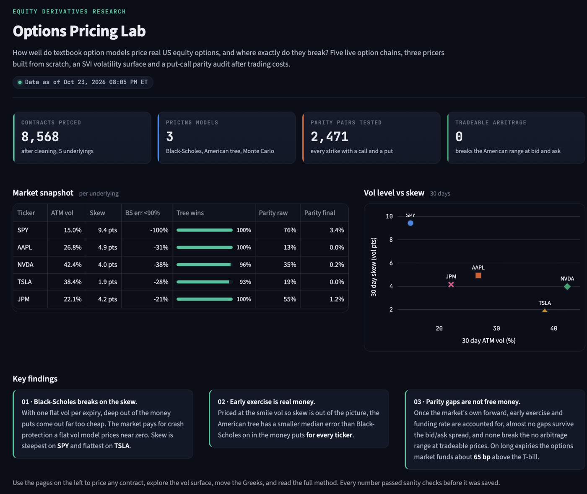
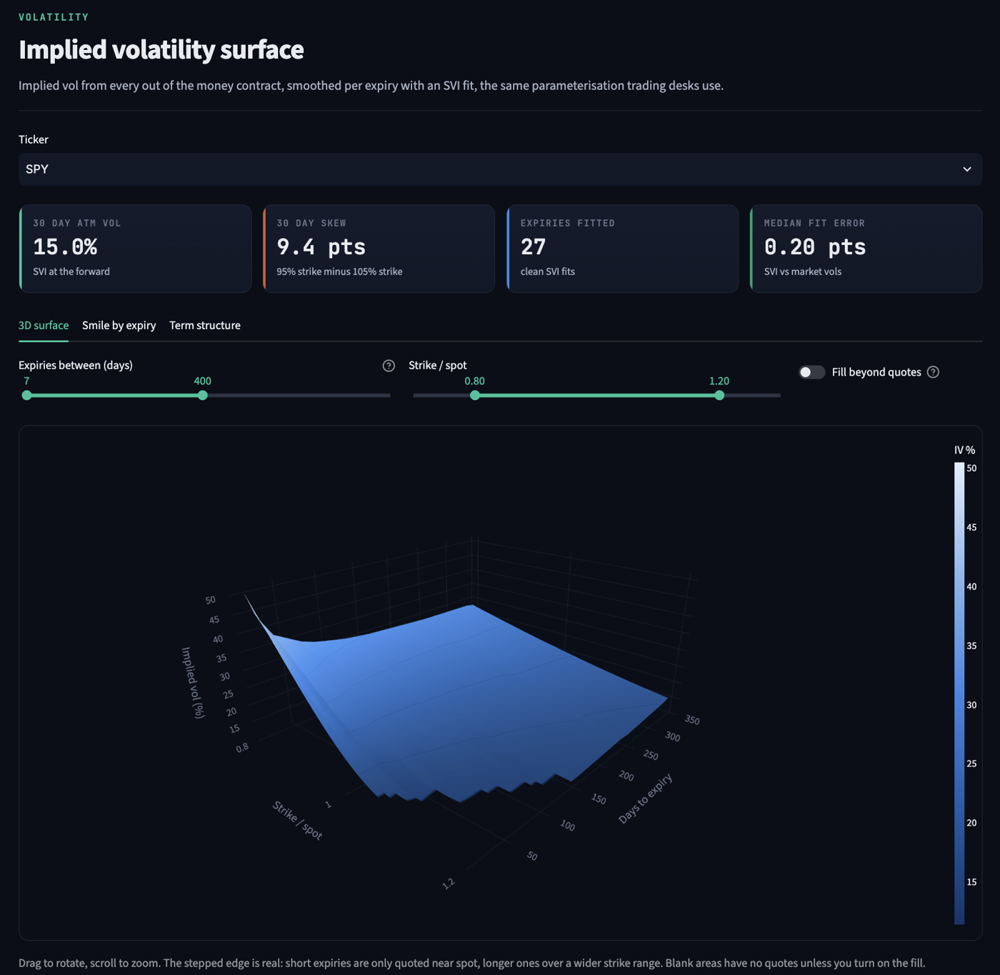

# Options Pricing Lab

Three option pricing models built from scratch, tested against 8,568 live market prices on five US stocks and ETFs, with an SVI volatility surface, an arbitrage audit and a daily automated data pipeline.

**Live app: [options-pricing-lab.streamlit.app](https://options-pricing-lab.streamlit.app)** · **Desk memo: [docs/desk_memo.md](docs/desk_memo.md)**





## The question

How well do textbook option models price real US equity options, and where exactly do they break?

## The answer

I priced 8,568 listed options on SPY, AAPL, NVDA, TSLA and JPM three ways, all written from scratch: Black-Scholes, a 500 step American binomial tree, and Monte Carlo with 100,000 antithetic paths. Then I compared every price to the market. The figures below are from the October 23, 2026 close. The live app refreshes with every trading day.

1. **Black-Scholes breaks on the skew.** With one vol per expiry, deep out of the money puts come out far too cheap: the median error on puts struck below 90% of the forward runs from -21% on JPM to -100% on SPY. The market charges real money for crash protection that a flat vol model prices near zero. The 30 day skew (vol at a 95% strike minus a 105% strike) is steepest on SPY at 9.4 vol points and flattest on TSLA at 1.9.

2. **Early exercise is real money, and the American tree captures it.** Priced at the smile vol so the skew is out of the picture, the binomial tree cuts the median error on in the money puts by 86% to 88% against Black-Scholes, on every ticker. SPY: $7.08 down to $0.92.

3. **Put-call parity gaps are not free money.** 1,134 of 2,471 call and put pairs look mispriced at first. Using the market's own forward leaves 670. Removing American early exercise leaves 46. Using the market's own funding rate leaves 21. **Zero** break the no arbitrage range at prices you can actually trade.

4. **The options market funds above the T-bill.** Put-call parity says call minus put is a straight line in the strike, and its slope is the discount factor the market really uses. That slope implies a funding rate a median 65 basis points over the 3 month T-bill. Past one year all five underlyings agree, at 4.45% to 5.25% against a 4.20% T-bill. This is the box spread rate that derivatives desks track.

5. **Earnings show up in the surface.** Options price a ±4.3% move on Apple's November 2 report and ±6.1% on Nvidia's November 18 report, read from the jump in total variance between the expiries either side of each date. Both show as a clear bump in at the money vol. On test data with planted moves of 7.00% and 4.50%, the method recovered 7.04% and 4.48%.

## What it does

| Step | What happens | Where |
|---|---|---|
| Pull | Option chains from Yahoo Finance, saved as timestamped Parquet snapshots | `src/data_pull.py` |
| Clean | Midpoint price; drops zero bids, open interest under 100, spreads over 20% of mid, stale quotes and arbitrage violations. Every filter logs its count | `src/clean.py` |
| Inputs | Time to 4 PM on expiry day, 3 month T-bill from FRED, dividend yield | `src/inputs.py` |
| Price | Black-Scholes, American binomial tree, Monte Carlo, plus all five Greeks | `src/pricing.py`, `src/greeks.py` |
| Converge | Tree and Monte Carlo checked against Black-Scholes as steps and paths grow | `src/convergence.py` |
| Implied vol | Brent's method on every contract, failures logged with a reason, forward read from put-call parity | `src/implied_vol.py` |
| Surface | SVI fit per expiry with positive variance, Lee's wing bound, butterfly and calendar arbitrage checks | `src/surface.py` |
| Model vs market | Error by moneyness and expiry, flat vol and smile vol tests | `src/model_vs_market.py` |
| Parity | Five stage funnel, implied funding rate, model free arbitrage bounds | `src/parity.py` |
| Daily job | GitHub Actions pulls new chains after every close and reruns the pipeline | `.github/workflows/daily_snapshot.yml` |
| App | Seven page Streamlit app on the saved results | `app.py`, `app_pages/` |

## How the results were verified

Every step has hard sanity checks that stop the pipeline instead of saving bad data, and 69 unit tests cover the pricers and the implied vol solver. Some of what they caught:

- **Stale contracts.** Yahoo still lists NVDA strikes from before its 2024 stock split, last traded in June 2024, with call prices above the stock price. A no arbitrage check flagged them, and a stale trade filter removed them.
- **The wrong forward.** The vol smile showed a jump between calls and puts at the money. The cause was the forward: SPY options trade until 4:15 PM while the stock closes at 4 PM, and a trailing dividend is not an expected one. Reading the forward from put-call parity removed the jump and cut SVI fit errors by 30% to 70%.
- **Early exercise hiding in parity.** Parity is a European rule. Read naively off American prices, it put long dated forwards up to 0.5% too low in testing. Stripping each option's early exercise value with the tree fixed it, confirmed on test data with a known forward.
- **A funding rate, not a mispricing.** The largest leftover parity gaps grew in a straight line with strike on 2 year SPY options. That is the signature of a discount rate, not of mispriced options. Fitting it recovered a known 80 bp test spread at 65 to 72 bp and a known 0 bp spread at 0.

Test data with planted answers was used throughout: a known forward, a known funding rate, a known earnings move. Every method had to recover the planted value before it ran on market data.

## Run it yourself

```bash
git clone https://github.com/dhairya1310/options-pricing-lab.git
cd options-pricing-lab
python3 -m venv .venv && source .venv/bin/activate
pip install -r requirements.txt
echo "FRED_API_KEY=your_key" > .env        # free key from fred.stlouisfed.org

python -m pytest -q                         # 69 tests
python -m src.data_pull                     # then, in order:
python -m src.clean
python -m src.inputs
python -m src.implied_vol
python -m src.greeks
python -m src.surface
python -m src.model_vs_market
python -m src.parity
python -m src.convergence
python -m src.memo_stats --earnings AAPL=2026-11-02 NVDA=2026-11-18
streamlit run app.py
```

## Limitations

- **Yahoo data is delayed end of day data.** Quotes on different contracts are not perfectly simultaneous, so small inconsistencies are expected, most of all on thinly traded strikes and long dated options.
- **The midpoint is an approximation.** The true price can sit anywhere inside the bid/ask spread. Some deep in the money AAPL calls have no implied vol because their midpoint sits a median 17 cents under the arbitrage floor while their spread is about $3.20 wide.
- **American options are priced with the binomial tree only.** Black-Scholes and Monte Carlo are European by construction, which is the point of comparing them.
- **Dividends are a continuous yield.** Real dividends are paid in lumps on set dates. This is the most likely reason a few parity gaps survive every adjustment, since deep in the money American calls are worth exercising just before an ex-dividend date.
- **The pricers discount at the T-bill.** The parity check measures the market's own funding rate, but the pricers do not use it yet.
- **Thin chains fit worse.** JPM has the fewest liquid contracts, and its shortest expiries have only a handful of quotes.

## Tools

Python (numpy, scipy, pandas), yfinance, fredapi, Plotly, Streamlit, GitHub Actions, Streamlit Community Cloud. No pricing libraries: every model, solver and fit is written in this repo.

## Author

Dhairya Shah · [GitHub](https://github.com/dhairya1310)
